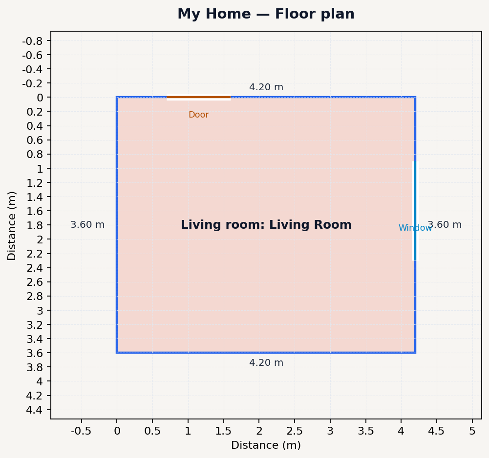
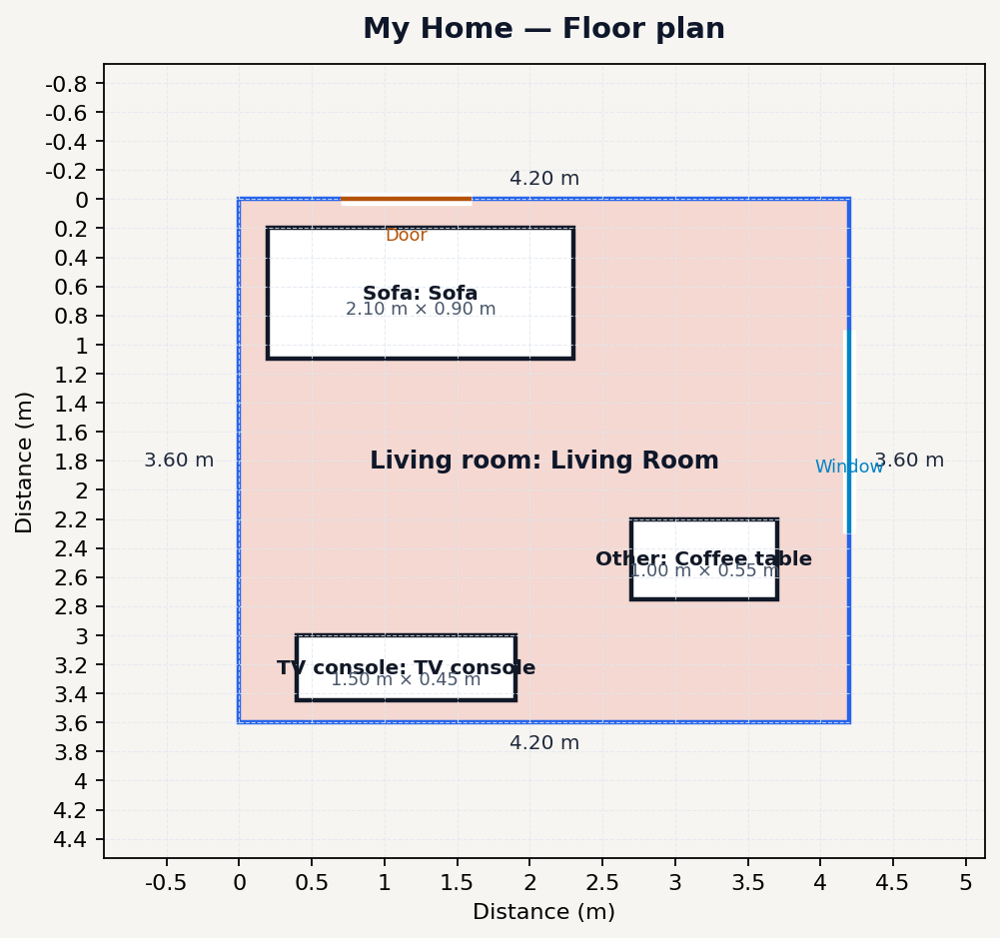
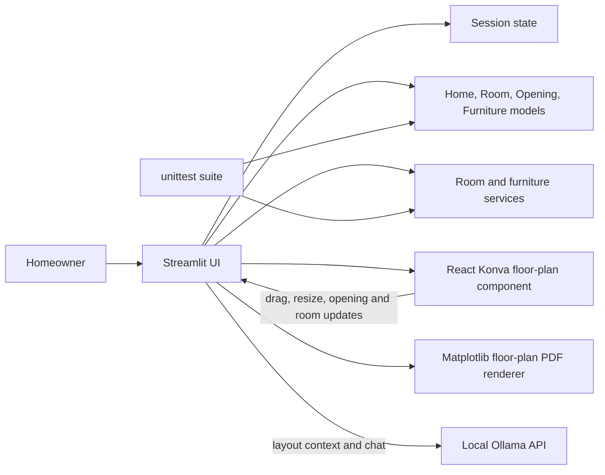

# Home Planner Project Overview

## Project Overview

Home Planner is a browser-based planning tool for homeowners and renters who want to make better furniture and space decisions before buying or rearranging items. Users enter room dimensions, add doors and windows, place measured furniture on an interactive 2D floor plan, and check whether each item fits within its room. They can download the plan as a PDF. An optional AI Space Assistant answers layout questions using the current room and furniture data through a locally running Ollama model.

The product is dimension-first rather than photorealistic: it helps users reason about real measurements and placement, not produce professional interior-design renders.

## Problem Statement

Homeowners often have to estimate whether a new sofa, bed, cabinet, or appliance will fit. Product listings may provide accurate dimensions, but translating those measurements into a room layout is left to mental arithmetic, tape-measure experiments, or rough sketches. This makes it easy to overlook blocked doors, awkward arrangements, or space that becomes difficult to use.

Home Planner brings room measurements and furniture dimensions into one simple visual workspace. It helps users test placement before purchasing and inspect a plan rather than relying on guesswork. The current fit check is limited to room boundaries; it does not yet assess walking paths or furniture-to-furniture collisions.

## Target Users and Value

- **Homeowners and first-time buyers:** explore furniture choices before purchasing or moving in.
- **Renters and people relocating:** map a room quickly and see how existing or proposed furniture can fit.
- **Families and household planners:** compare room arrangements and keep a simple floor-plan PDF.
- **People furnishing a room:** enter product dimensions directly or start with a common furniture type and adjust its measurements.

The app is intended for everyday planning, not architectural, engineering, accessibility, fire-safety, or building-code decisions.

## Current Features: V1 Implemented

The following behaviors are present in the current application:

- Create, name, edit, and delete rectangular rooms. Room dimensions are stored internally in centimeters.
- Choose display measurements in centimeters, meters, inches, or feet.
- Add doors and windows, edit their names and dimensions, move them along walls in the plan, or delete them.
- Attach rooms against another room to create a connected, multi-room 2D layout.
- Place furniture from common types or use a custom item; edit dimensions and rotate by 90 degrees.
- Drag furniture on the interactive plan and resize it with the canvas controls.
- Reject furniture placements whose rotated or unrotated bounds extend beyond the room.
- Export a PDF floor plan, with connected rooms on one plan or separate pages for unconnected rooms.
- Open an optional chat assistant that uses the current home layout as context. It connects to Ollama on the local machine and can be configured with `OLLAMA_URL` and `OLLAMA_MODEL`.

The current fit check validates room boundaries only. Furniture overlap, door swing clearance, recommended walkway widths, and code-compliance checks are not implemented. The current application is 2D; a 3D shell is a future enhancement, not a V1 capability.

## V2 and Future Features

Prioritized from the product roadmap; these are planned capabilities, not claims about the current implementation:

- **Fit and circulation analysis:** furniture-to-furniture overlap detection, remaining clearance measurements, door or cabinet swing checks, and walkway-width warnings with explanations.
- **Shopping planner:** save candidate products, compare their dimensions, test placements, and review their effect on usable space.
- **More capable space assistant:** offer contextual layout alternatives and explain recommendations based on explicit clearance rules and household needs.
- **Whole-home organization:** persist projects, organize rooms and zones, switch between rooms, and review warnings across the home.
- **Richer room modeling:** add a 3D room shell, support more complex room shapes, and provide optional floor-plan tracing or room-connection improvements.
- **Usability and portability:** improve project save/load and sharing workflows, add more unit and layout preferences, and validate accessibility and responsive behavior.

These features should be prioritized with homeowner testing. Recommendations involving safety, accessibility, or building rules must identify their assumptions and should not be presented as professional approval.

## UI and UX

### User Flow

1. Open the planner and name the home.
2. Select a display unit and add a room with a type, name, width, and length.
3. Add doors and windows, then adjust their dimensions and position on the floor plan.
4. Add furniture, choose or edit its dimensions, rotate it, and place or resize it on the canvas.
5. Review the fit result, adjust the layout, and attach rooms when a connected overview is useful.
6. Download the floor-plan PDF or open the AI Space Assistant for a layout question.

### Screenshots

The following sample plan images are generated by the application's Matplotlib renderer, which is also used for PDF export. They show actual application output, not the full Streamlit interface.



*Figure 1. A measured living room with a door, window, and wall dimensions.*



*Figure 2. A sofa, coffee table, and TV console placed inside the same room.*

### UX Principles

- Keep room and furniture setup measurement-led, with unit conversion at the interface.
- Provide immediate visual feedback for placement and room-boundary fit.
- Use a simple 2D plan rather than requiring users to learn professional CAD workflows.
- Keep AI assistance optional and local; explain that Ollama must be running to use it.

## Technical Architecture



The Python application is launched from `app.py`. Streamlit renders the forms and coordinates session state. Domain objects in `home_planner/models.py` represent homes, rooms, openings, and furniture; measurements are stored in centimeters and converted for display by `home_planner/units.py`. Room and fit behavior lives in `home_planner/services/`. The interactive canvas is a React/Konva Streamlit component under `home_planner/konva_component/`; the PDF renderer is in `home_planner/rendering/`. The assistant sends layout context to a local Ollama server. Current project data is held in Streamlit session state and is not saved as a persistent project.

## Implementation Plan and Milestones

| Milestone | Scope | Status |
|---|---|---|
| 1. Room foundation | Room creation, editing, deletion, unit conversion, and a 2D dimensioned plan | Implemented |
| 2. Openings and multi-room layout | Door/window controls and positioning; attach rooms for a connected plan | Implemented |
| 3. Furniture planning | Furniture types and custom dimensions, rotation, canvas placement/resizing, and room-boundary fit checks | Implemented |
| 4. Shareable output | Export the current plan as a PDF | Implemented |
| 5. Optional AI help | Local Ollama chat with current room and furniture context | Implemented; requires Ollama and a compatible model |
| 6. V2 planning intelligence | Overlap and clearance analysis, walkway checks, shopping candidates, and explainable recommendations | Planned |
| 7. Persistence and richer planning | Save/load projects, improve whole-home organization, and evaluate 3D or tracing workflows | Planned |

## Testing and Validation

The project uses Python `unittest` tests. The suite covers unit conversions, room management and room attachment, furniture boundary-fit behavior including rotation, floor-plan rendering, and the Ollama chat client using a mocked HTTP response. Run it from the repository root:

```bash
python -m unittest discover -s tests -v
```

After installing the declared `matplotlib` dependency in the selected Python environment, all 21 tests passed in this workspace.

Additional release validation should cover room and furniture workflows in the browser, connected and unconnected PDF output, unit changes while editing, and the assistant both with Ollama available and unavailable. V2 clearance and overlap rules will need boundary cases and homeowner review against clearly stated assumptions.

## Limitations and Future Enhancements

- Rooms are rectangular; complex shapes and wall geometry are not modeled.
- Furniture is represented as a top-down footprint. Height is not currently used for fit checks or a 3D visualization.
- The fit check only checks that furniture stays within room bounds; it does not detect overlap with other furniture, openings, or circulation paths.
- Room and furniture state is session-based, so there is no durable save/load or account-based project management.
- The assistant depends on a locally installed and running Ollama server and model. Its advice is generated text, not a deterministic clearance engine or professional assessment.
- PDF and canvas behavior should be validated at different viewport sizes and with representative multi-room layouts.

Future work should first add reliable persistence and explicit geometric checks, then build explainable shopping and layout assistance on top of those validated rules. 3D visualization, tracing, and richer room geometry should follow only where user testing shows they improve practical decisions.
